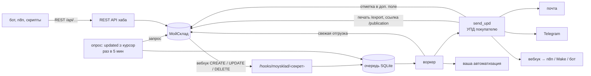

# Хаб отгрузок МойСклад

Общий сервис, на котором пишутся автоматизации вокруг отгрузок. Он сам узнаёт
об изменениях отгрузок в МойСклад, загружает их свежими и прогоняет через
автоматизации-плагины. Первая автоматизация — **УПД покупателю**: отгрузка
перешла в статус «Отгружен», и хаб сам печатает УПД и отправляет его на e-mail
контрагента, в Telegram или во внешнюю автоматизацию.

Всё тяжёлое уже решено в ядре, поэтому новая автоматизация — это один файл:
очередь, повторы, защита от двойной отправки, лимиты API, пробный режим, журнал
и алерты.

## Как устроено



| Модуль | Что делает |
|---|---|
| `hub/moysklad.py` | клиент API: Bearer, обязательный gzip, лимит 40 запросов за 3 с (у API — 45), повторы на 429 и 5xx, пагинация, печать (303 → файл), публикации, доп. поля, вебхуки |
| `hub/ingest.py` | приём вебхука (ответ за миллисекунды, дубли по `requestId` отсекаются) и страховочный опрос по `updated` |
| `hub/store.py` | SQLite: очередь событий, журнал запусков, курсор опроса |
| `hub/engine.py` | события → свежая отгрузка → автоматизации; один успешный запуск на ключ; повторы 1 мин → 5 мин → 30 мин → 2 ч → 6 ч → алерт |
| `hub/automations/` | плагины; `send_upd.py` — УПД, `_template.py` — заготовка новой |
| `hub/channels/` | почта (SMTP), Telegram, исходящий вебхук; режим `HUB_DRY_RUN` выключает их все разом |
| `hub/app.py` | HTTP: вебхук, `/healthz`, REST API |
| `hub/__main__.py` | командная строка: `serve`, `check`, `setup`, `webhooks`, `run`, `journal`… |

Почему именно так — из документации МойСклад в этом форке:

- МойСклад ждёт ответ на вебхук не дольше 1500 мс, потом делает ещё 3 попытки подряд
  и выбрасывает уведомление. Поэтому вебхук только кладёт событие в очередь.
- Вебхуки работают только на платных тарифах и не гарантируют доставку. Поэтому
  есть опрос: он подхватит всё, что вебхук потерял.
- Защита от повтора хранится в двух местах: в журнале хаба и в доп. поле отгрузки
  «УПД отправлен». Отметку видят менеджеры, и она спасает, даже если база хаба
  пропала при релизе.

## Гарантии

- **Без двойной отправки.** Пара «автоматизация + отгрузка» успешно выполняется один раз.
  Если упал второй канал, первый при повторе не дублируется.
- **Без потерь.** Сбой МойСклад или почты — повтор по расписанию. Через 6 попыток —
  статус `dead` и сообщение в `HUB_ALERT_CHAT`. Упавший процесс после рестарта
  доделывает незавершённые запуски.
- **Безопасный старт.** По умолчанию `HUB_DRY_RUN=1`: хаб пишет в журнал, что и кому
  отправил бы, но ничего не отправляет. Первый запуск не трогает старые отгрузки:
  курсор опроса ставится на «сейчас».

## Быстрый старт (локально)

```bash
cd apps/shipments-hub
python3 -m pip install -r requirements-dev.txt
python3 -m pytest -q && ruff check .        # 19 тестов на поддельном МойСклад

cp .env.example .env                        # заполнить MOYSKLAD_TOKEN, остальное по желанию
set -a; . ./.env; set +a
python3 -m hub check                        # что настроено, чего не хватает
python3 -m hub states                       # статусы отгрузок — имя для config.yaml
python3 -m hub templates                    # шаблоны печати — имя УПД
python3 -m hub setup                        # создать доп. поле «УПД отправлен»
python3 -m hub run send_upd 00123           # пробно на реальной отгрузке (dry-run)
python3 -m hub serve                        # сервер на :8080
```

## Настройка

**Секреты и адреса** задаются в переменных окружения, полный список с пояснениями —
в [`.env.example`](.env.example). Главные:

| Переменная | Зачем |
|---|---|
| `MOYSKLAD_TOKEN` | токен сотрудника МойСклад с правами на отгрузки, печать и доп. поля |
| `HUB_DRY_RUN` | `1` — только журнал (так начинать), `0` — отправлять по-настоящему |
| `HUB_WEBHOOK_SECRET`, `HUB_PUBLIC_URL` | адрес для вебхуков МойСклад: `https://‹домен›/hooks/moysklad/‹секрет›` |
| `HUB_API_KEY` | ключ для REST API хаба |
| `HUB_DB` | файл базы; на хостинге — постоянный диск `/data` |
| `SMTP_*` | почта, от имени которой уходят УПД |
| `TELEGRAM_BOT_TOKEN`, `HUB_ALERT_CHAT` | Telegram для файлов и алертов |

**Правила автоматизаций** — в [`config.yaml`](config.yaml): статус-триггер, шаблон,
каналы, тексты писем с подстановками `{number} {date} {sum} {agent} {organization} {link}`.
Это не секрет, его стоит держать в git и проверять на ревью. Опечатку в имени
параметра хаб не проглотит молча, а откажется стартовать.

## REST API для других автоматизаций

Нужен заголовок `X-Api-Key` (для ссылок из браузера — `?key=`). Отгрузку можно
указать номером, как в МойСклад, или id.

```bash
H="X-Api-Key: $HUB_API_KEY"; HUB=https://hub.example.ru
curl -H "$H" "$HUB/api/shipments?days=1&state=Отгружен"      # отгрузки за сутки
curl -H "$H" "$HUB/api/shipments/00123"                        # отгрузка + журнал по ней
curl -H "$H" -o upd.pdf "$HUB/api/shipments/00123/print"       # УПД файлом
curl -H "$H" "$HUB/api/shipments/00123/print?template=ТОРГ-12&format=xls" -o torg12.xls
curl -H "$H" "$HUB/api/shipments/00123/link"                   # публичная ссылка mskld.ru
curl -H "$H" -X POST "$HUB/api/shipments/00123/run/send_upd"   # отправить УПД сейчас
curl -H "$H" "$HUB/api/journal?status=failed"                  # что не получилось
curl "$HUB/healthz"
```

Внешняя автоматизация (бот, n8n, Make) может как брать данные отсюда, так и получать
их сама: канал `webhook` у `send_upd` присылает JSON с отгрузкой, ссылкой и файлом
УПД в base64.

## Автоматизации

| Имя | Когда | Что делает | Отметка |
|---|---|---|---|
| `send_upd` | отгрузка в статусе `state` (по умолчанию «Отгружен») | печатает УПД по шаблону и отправляет: письмо контрагенту, файл в Telegram, вебхук | доп. поле «УПД отправлен» |

Новая автоматизация: скопировать `hub/automations/_template.py`, включить в `config.yaml`
и написать тест на поддельном МойСклад. Пошагово — скил
[`.claude/skills/new-automation`](../../.claude/skills/new-automation/SKILL.md).

## Деплой

Dockhost, по той же схеме, что прайс `Coer911/ccr-price-standalone`: `Dockerfile`
и `dockhost.yaml` лежат в этой папке, сборка — из неё. Реплика строго одна. Порт
`8080`, постоянный диск — в `/data`. Пошагово, с проверкой после релиза и
поиском неисправностей — скил [`.claude/skills/deploy-hub`](../../.claude/skills/deploy-hub/SKILL.md).

## Что проверено, а что нет

- ✅ 19 тестов на поддельном МойСклад: формы ответов взяты из документации форка.
  Проверено: вебхук, опрос, дубли, повторы, частичный сбой каналов, отметка
  в МойСклад, dry-run, REST API, токен не уходит на чужой хост.
- ✅ Docker-образ собирается и стартует, `/healthz` отвечает.
- ⚠️ С живым МойСклад не запускался: из облачной сессии сеть до api.moysklad.ru
  закрыта. Первый шаг на настоящем аккаунте — `python -m hub check`.
- ⚠️ Имя статуса («Отгружен») и шаблона УПД у каждого аккаунта своё. `check` покажет
  расхождения, а `states` и `templates` — правильные имена.
- ⚠️ Поля `dockhost.yaml` скопированы с рабочего прайса. Порт, переменные и диск
  задаются в панели Dockhost.

## Что ещё можно построить на хабе

- **Маршрутный лист на завтра**: `/api/shipments?days=1` с адресами доставки (`shipmentAddress`)
  → готовый лист для логиста в Telegram к 17:00.
- **Комплект документов**: к УПД добавить счёт или ТОРГ-12 одним PDF
  (в `/export` есть `templates[]`, см. `documents/_print.md`).
- **Напоминание о неоплате**: `payedSum < sum` через N дней после отгрузки → менеджеру.
  Для этого ядру понадобится плановый запуск автоматизаций, а не только по событиям.
- **Отгрузка → Telegram менеджеру/складу** с составом (`demand_positions`).
- **ЭДО**: юридически значимая отправка УПД через Диадок или СБИС как ещё один канал.
- **Журнал отгрузок в Google Таблицу** для бухгалтерии.
