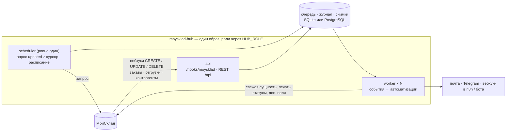

# Архитектура

## Слои

| Слой | Модули | Правило |
|---|---|---|
| Клиент МойСклад | `hub/moysklad/client.py`, `fields.py` | единственное место, где делается HTTP к МойСклад: токен, gzip, лимит, повторы, пагинация, кеш метаданных; статусы и доп. поля по именам |
| Модель | `hub/entities.py`, `hub/events.py` | заказ, отгрузка, контрагент в удобном виде; новый тип — класс и строка в `TYPES` |
| Хранилище | `hub/storage/` | очередь, журнал запусков, снимки статусов, курсоры; SQLite и PostgreSQL одним кодом |
| Движок | `hub/engine.py` | события → свежая сущность → автоматизации; идемпотентность, повторы, расписание |
| Приём | `hub/ingest.py` | вебхук → очередь; опрос по `updated` с курсором на тип |
| Автоматизации | `hub/automations/` | плагины; наружу — только `ctx.channels`, в МойСклад — только `ctx.set_state` / `ctx.set_fields` |
| Каналы | `hub/channels/` | почта, Telegram, исходящий вебхук; `HUB_DRY_RUN` выключает их разом |
| Вход | `hub/api/`, `hub/__main__.py`, `hub/runtime.py` | HTTP, CLI, роли процесса |

Автоматизация не знает про HTTP, базу и очередь. Поэтому её можно протестировать
на поддельном МойСклад и запустить хоть в одном процессе, хоть на десяти воркерах.

## Гарантии

- **Один раз.** Пара «автоматизация + ключ» успешно выполняется один раз:
  `storage.try_start` — атомарный INSERT/UPDATE. Ключ выбирает автоматизация:
  «раз на отгрузку», «раз на вход в статус», «раз на переход».
- **Отметка в МойСклад.** `mark_field` — доп. поле, которое видят менеджеры и которое
  спасает от повтора, даже если база хаба потеряна.
- **Шаги.** Несколько каналов в одной автоматизации отмечаются по отдельности. Упал Telegram —
  письмо при повторе второй раз не уйдёт.
- **Переходы статусов.** Снимок `(тип, id) → статус, updated` двигается только вперёд.
  Устаревшее или повторное событие не создаёт ложный переход.
- **Сбои.** Автоматизация — повтор 1 мин → 5 мин → 30 мин → 2 ч → 6 ч → `dead` и алерт.
  Событие, которое не удаётся разобрать, например лёг МойСклад, возвращается в очередь,
  а после 20 попыток списывается.
- **Падение процесса.** Аренды (`lease`) истекают, и брошенную работу подхватывает другой
  воркер или тот же после рестарта.
- **Лимиты МойСклад.** С 2026 года лимит считается на пользователя, и для токена
  пользователя у запроса есть вес: сейчас 15 запросов за 3 с, с 01.12.2026 — 11.
  Хаб держит этот график сам (`MOYSKLAD_RPS` — переопределить).

## Масштабирование

Тот же образ, другая роль. Код автоматизаций не меняется.

| Этап | Как запущено | Когда |
|---|---|---|
| 1 | один контейнер, `HUB_ROLE=all`, SQLite на диске `/data` | сейчас: десятки–сотни документов в день |
| 2 | один контейнер `all` + PostgreSQL (`HUB_DATABASE_URL=postgresql://…`) | нужен надёжный бэкап, нет постоянного диска |
| 3 | контейнеры `api` ×2, `worker` ×N, `scheduler` ×1–2 + PostgreSQL | тысячи событий в день, тяжёлые автоматизации |

На этапе 3:
- `api` без состояния — реплик сколько угодно за балансировщиком.
- `worker` берут события через `FOR UPDATE SKIP LOCKED` и не мешают друг другу.
- `scheduler` можно поднять два для отказоустойчивости: работает тот, кто взял
  `pg_advisory_lock`, второй ждёт.
- Лимит МойСклад общий на токен: при N воркерах с одним токеном задайте `MOYSKLAD_RPS ≈ лимит / N`
  или выдайте воркерам разные токены (разные пользователи — разные лимиты).

Проверено тестами на настоящем PostgreSQL 16: эксклюзивный захват событий, гонка
за запуск, два воркера на одной базе (одно письмо), единственный лидер планировщика.

## Расширение

- **Новая автоматизация** — `hub/automations/<имя>.py` по `_template.py`, запись в
  `config.yaml`, тест. Скил `new-automation`.
- **Новый тип сущности** (счёт покупателю, приёмка, возврат) — класс в `hub/entities.py`,
  строка в `TYPES` и `ALIASES`. Опрос, вебхуки, REST и статусы заработают для него сами.
- **Новый канал** (ЭДО Диадок / СБИС, WhatsApp) — метод в `hub/channels/`. Он сразу уважает dry-run.
- **Миграции схемы** — сейчас таблицы создаются при старте (`create_all`). Первое изменение
  существующей таблицы — повод подключить Alembic.
